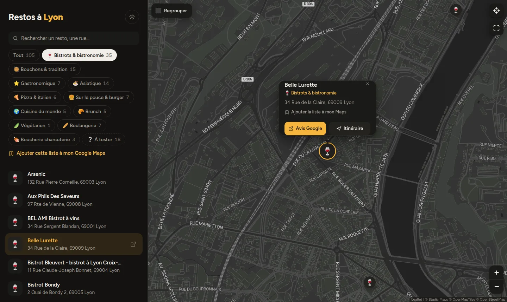
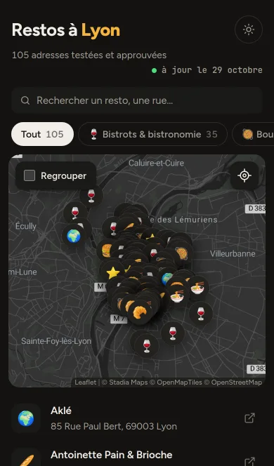

# miam 🍽️

**Turn your Google Maps lists into a clean, shareable restaurant map.**

You already save your favourite places in Google Maps. miam reads those lists and publishes them as a fast, read-only, mobile-friendly map your friends can bookmark. You keep curating in the Google Maps app on your phone; the site follows on its own.

**Live:** [miam.pateenchroot.ovh](https://miam.pateenchroot.ovh), my favourite restaurants in Lyon.

<p align="center">
  
  &nbsp;
  
</p>

## Features

- **One Google Maps list = one category.** The list's name and emoji become a filter and the map marker.
- **Automatic sync** every hour. Add a place in Google Maps and it shows up on the site, with no redeploy.
- **Search** by name or street, accent-insensitive.
- **Locate me**, Google reviews and directions links on every place.
- **"Add this list to my Google Maps"** for the lists you mark as public: visitors follow them in their own app.
- **Hidden lists**, e.g. a "to try" list kept out of the default view.
- Dark and light themes, optional marker grouping, fullscreen map, works well on phones.
- **Resilient:** a failed sync never empties the site; the last good snapshot is kept and the error is logged.
- **Small:** one Go binary, no database, a ~6 MB Docker image, a single HTML page.

## How it works

```
Google Maps shared lists ──(hourly)──▶ miam (Go) ──▶ snapshot.json
                                          │
                                          └──▶ GET /           single page (Leaflet)
                                               GET /api/places merged places + categories
```

miam reads each list through the endpoint the Google Maps web app uses for shared lists. **It is not an official API**: Google can change it at any time. When that happens the site keeps serving the last snapshot while the parser gets fixed.

Map tiles come from [Stadia Maps](https://stadiamaps.com/) (free tier, authorized by domain, no key in the code). Google ratings are not embedded in the page: Google's terms only allow that on a Google map, so each place links to its Google Maps page instead.

## Configuration

Share each list from Google Maps (*Saved → list → Share*) and put the links in a JSON file. The order is the order of the filters, and the first list a place belongs to gives its marker emoji.

```json
{
  "lists": [
    { "url": "https://maps.app.goo.gl/AAAA", "public": true },
    "https://maps.app.goo.gl/BBBB",
    { "url": "https://maps.app.goo.gl/CCCC", "hidden": true }
  ],
  "syncInterval": "1h"
}
```

| Field | Meaning |
|---|---|
| `url` | The list's share link. A bare string is a private list. |
| `public` | Shows the share link on the site so visitors can follow the list in Google Maps. The list page shows your Google name and avatar. |
| `hidden` | Kept out of "all", the map and the counts until its filter is selected. |
| `syncInterval` | Go duration, at least `1m`. Defaults to `1h`. |

Private lists stay private: the site never serves their link or their Google list ID, nor the personal notes you add to places.

## Run it

With Docker:

```sh
docker build -t miam .
docker run -d --name miam -p 8080:8080 \
  -v "$PWD/config.json:/config/config.json:ro" \
  -v miam-data:/data \
  miam
```

Or from source (Go 1.22+):

```sh
cp config/config.example.json config/config.json   # then add your links
go run ./cmd/miam
```

Then open http://localhost:8080. In production, put it behind a TLS reverse proxy (geolocation needs HTTPS) and add your domain to your Stadia Maps account.

| Flag | Default | |
|---|---|---|
| `-config` | `config/config.json` | list configuration |
| `-data` | `data/snapshot.json` | last good sync |
| `-addr` | `:8080` | listen address |
| `-healthcheck` | | probe `/healthz` and exit (used by the image's `HEALTHCHECK`) |

## Development

```sh
go test ./...
```

The front end is a single file, [`web/index.html`](web/index.html), embedded into the binary: vanilla JS, [Leaflet](https://leafletjs.com/) and [Leaflet.markercluster](https://github.com/Leaflet/Leaflet.markercluster) from a CDN, no build step.

## License

[MIT](LICENSE)
