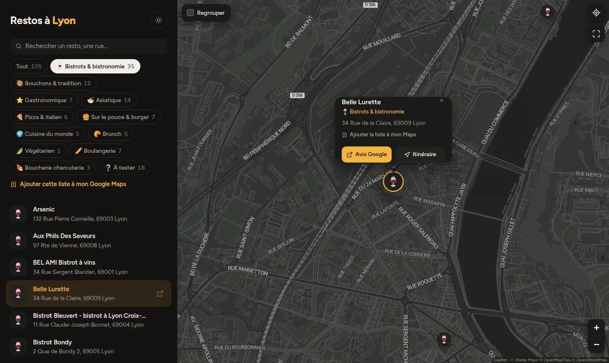
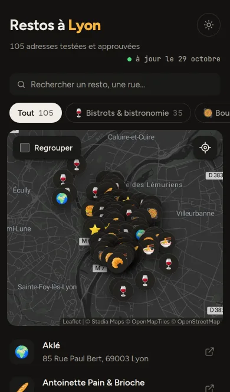

# miam 🍽️

**Turn your Google Maps lists into a clean, shareable restaurant map.**

You already save your favourite places in Google Maps. miam reads those lists and publishes them as a fast, read-only, mobile-friendly map your friends can bookmark. You keep curating in the Google Maps app on your phone; the site follows on its own.

**Live:** [miam.pateenchroot.ovh](https://miam.pateenchroot.ovh), my favourite restaurants in Lyon.

  
  &nbsp;
  

## Features

- **One Google Maps list = one category.** The list's name and emoji become a filter and the map marker.
- **Automatic sync** every hour. Add a place in Google Maps and it shows up on the site, with no redeploy.
- **Search** by name or street, accent-insensitive.
- **Locate me**, Google reviews and directions links on every place.
- **"Add this list to my Google Maps"** for the lists you mark as public: visitors follow them in their own app.
- **Hidden lists**, e.g. a "to try" list kept out of the default view.
- Dark and light themes, optional marker grouping, fullscreen map, works well on phones.
- **Resilient:** a failed sync never empties the site; the last good version stays online.

## Your own miam

Want the same for your lists? Share them from Google Maps, put the links in a small config file and run miam on a server. [docs/SETUP.md](docs/SETUP.md) walks through it.

miam relies on an unofficial Google Maps endpoint, so a Google change can pause the sync for a while; the site keeps showing the last good version in the meantime.

## License

[MIT](LICENSE)
